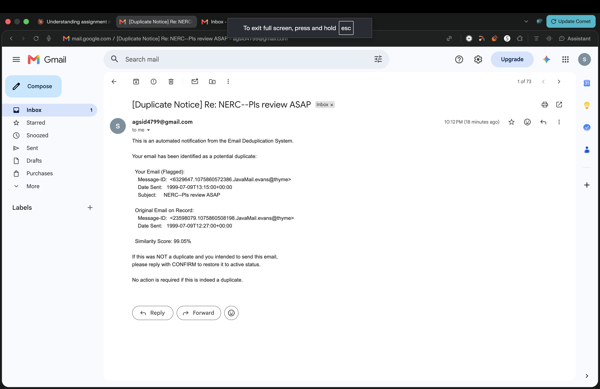

# AI usage

How AI tools were used to build this project. Everything below comes from `scratch_notes.md` (which covers my earlier exploration), `docs/PROGRESS.md`, the git history, `BUILD_PROMPT.md` and my Claude chat history. The sections on the % split, lessons learned, my own contributions and the other prompts I used were drafted with Claude chat from what actually happened in this project, then checked and edited by me.

## Tools used

| Tool | Version | Used for |
|---|---|---|
| Claude (chat, claude.ai) | Claude Opus 5.5 | analysis, exploring the dataset, planning, drafting `BUILD_PROMPT.md`, and helping debug the live sends |
| Claude Code | 2.1.295 (`claude --version`), model Claude Opus 5.5 (`claude-opus-5-5`), as recorded in docs/PROGRESS.md phase 0 | reviewing and fixing my first exploration scripts, then building this whole repository from `BUILD_PROMPT.md` (phases 0 to 9 in one session, then the audit, the fixes and the live-send docs) |
| Claude (a second, separate chat) | claude.ai | reviewed the plan before the build and produced the "Final Reviewed Roadmap", which compares the two approaches |

Every commit in this repository was made through Claude Code and ends with `Co-Authored-By: Claude Opus 5.5`.

## Prompting strategy

I worked in two stages.

1. **Exploration, task by task (Claude chat, then Claude Code review).** I first explored the dataset and the mailbox-selection idea step by step. The first scripts had several mistakes (listed under [Iterations and debugging](#iterations-and-debugging)), and those findings became the hypotheses in the build prompt.
2. **The build: the full spec at once, as phases.** For the build I gave Claude Code one long prompt, `BUILD_PROMPT.md`, saved word for word in the repo. It splits the work into phases 0 to 9 in the order the spec's tasks depend on each other (helpers, selection, EDA, extraction, database, duplicates, notifications, main and tests, docs, final check). After each phase Claude Code had to run it, check the numbers, update `docs/PROGRESS.md`, log problems in `scratch_notes.md` and commit before moving on. The git history shows one commit per phase.

Example prompts, all quoted from `BUILD_PROMPT.md`, with why each was shaped that way:

**1. Phases, checkpoints and stop conditions**

> Build the whole project end to end by working through the phases below in order.
> After each phase: run it, check the numbers, update docs/PROGRESS.md (phase, status, key numbers, commit hash), add any real problem you hit and how you fixed it to scratch_notes.md, commit with a clear message, then keep going without waiting for me unless a stop condition happens. If you get cut off, I'll start a new conversation and say "continue from docs/PROGRESS.md", so keep that file accurate.
>
> ## Stop and ask me if
> - you need my Gmail credentials. I'll create .env myself. Never ask me to paste a password into the chat.
> - anything would send a real email. Never run --send-live yourself.

Why: one prompt for the whole build only works if progress survives a cut-off, so PROGRESS.md is the resume point and each phase ends in a commit. The stop conditions draw a hard line around credentials and real email, the two things an autonomous run must never get wrong. Claude Code never ran `--send-live` against Gmail; every live-mode check used a fake SMTP (docs/PROGRESS.md, phase 6).

**2. Measure first, then decide**

> Measure first, then decide. Every rule and threshold needs a reason: a line from the spec or a number from the data. Put a one-line reason in a comment where the rule lives, and a full entry in docs/DECISIONS.md: what we decided, why (spec section or data number), what else we considered, and how we checked it. If the data shows any rule below is wrong, change it, log why in DECISIONS.md, and mention it in the phase summary.

Why: in my first attempt the rules that went wrong (ranking by an average, counting files as unique emails) were ones nobody had checked against the data (scratch_notes.md). This line made the build check every rule before trusting it. In phase 2 the EDA changed seven rules (docs/PROGRESS.md), for example "Outlook Original Message is a reply marker", which was wrong for the 1,281 of 3,740 Outlook emails that were really forwards.

**3. Hypotheses to re-verify, not facts**

> ## Notes from an earlier exploration (re-verify all of it, don't trust it)
> I explored this dataset once before (notes in scratch_notes.md). Treat these as hypotheses for phases 1 to 3 to confirm or correct:
> - Plain text search is a trap: "To:" also matches "X-To:", and Cc lines inside quoted replies look like real Cc. Only parse the real header block.
> - Every file has its own Message-ID, even when it's a copy of the same email in another folder. In some mailboxes over half the files are such copies.
> ...
> - About 3% of emails have no To: header.

Why: the exploration had found real traps, and the build had to know about them. But some notes were rough, so each one was framed as a hypothesis to test. Phases 1 and 2 confirmed some (one Message-ID per file; Bcc a copy of Cc in all 68,456 emails that have it) and corrected others (no To header in 1.5% of the picked files, not 3%; most files mix CRLF headers with LF bodies rather than being pure CRLF) (docs/PROGRESS.md, phases 1 and 2).

**4. Exact rules for the numeric core**

> Walk each group in date order, ties broken by message_id:
> - Attach each email to the earliest original it scores 90+ against; otherwise it becomes a new original.
> - Identical texts score 100 without fuzzy matching (the fast path for folder copies).
> - Otherwise skip a pair when 20*min(m,n) < 9*(m+n), because fuzz.ratio can't reach 90 then.
> - Decide the 90 from rapidfuzz's whole-number Indel distance, not a rounded float.
> ...
> - Check the optimized matching against a plain compare-every-pair version on a small sample. They must give the same results.

Why: duplicate detection is where a small ambiguity (chains, ties, float rounding at exactly 90) silently changes the results, so the prompt spells the algorithm out and asks for an independent check of the shortcuts. The real data has a pair at exactly 90.0, and the plain matcher agreed on all 500 sampled groups (docs/PROGRESS.md, phase 5).

**5. MCP without risk**

> - --send-live: one notice per group, about the latest duplicate, sent through the MCP server's send_email tool using the mcp Python client. No direct SMTP from the pipeline.
>   - Send it to NOTIFY_TO, with intended_recipient set to the real sender.
>   - Write the ledger row as pending before sending and update it afterwards. Skip groups already sent. Don't retry a row left pending by a crash; report it instead.
> ...
> - Don't run --send-live. Test the server with an in-process MCP client call against a fake SMTP connection instead.

Why: the email step is the one with real-world side effects. The prompt routes it through the MCP tool, redirects every live notice to my own inbox, makes repeated runs safe with a ledger, and keeps the AI's own testing fake.

The prompt also fixes the code style ("Simple Python a student would write", "No spaces around = or comparison operators", `except Exception as e`), because that's how I write, and the comments are meant to let me follow the code later. Its `.venv` rule ("Always run .venv/bin/python") comes from the first attempt, where Claude Code used a different Python than my terminal (scratch_notes.md).

Besides the build prompt, these are the prompts that shaped the project:

- **The decision that changed the design** (first attempt): "Good review, thanks. Here's what I've decided, please update the selection script (analyze_mailboxes.py): 1. A "copy" is a file with the same From, To, Cc, Date, Subject and body (ignore whitespace differences) as another file. Build a fingerprint from those instead of using Message-ID..." The fingerprint idea came from Claude Code's review; I decided the exact fields and gave them as rules, so it implemented my definition.
- **The audit:** "Do a thorough check of this project against @ASSIGNMENT.md. Don't change any code or docs and don't commit. Just run things and report..." It had to show evidence for every requirement and check that the numbers add up, and it wasn't allowed to change anything, so the result was a report I could trust.
- **The fixes:** "Do all of 5 to 11, with these additions..." I approved specific fixes and attached conditions (a test for each code fix, outputs that stay byte-identical), which kept the scope under my control.
- **The MCP evidence:** "Fill in the MCP evidence in AI_USAGE.md. Leave the % split and lessons learned for me. Use only these facts..." I gave it only facts I had verified, so it couldn't invent anything.

## Iterations and debugging

These are real cases where AI-written code or a planned rule didn't work at first, and how they were fixed (from scratch_notes.md, docs/PROGRESS.md and the commits).

### From the first attempt (Claude chat, reviewed in Claude Code)

1. **Text search counted X-To as To.** The first selection script searched the whole file as text, so `To:` also matched `X-To:` and every mailbox showed 100% mandatory coverage. Fixed by parsing only the header block with the `email` module; real coverage was about 96 to 99%, and the gap was missing To: lines.
2. **A bare `except: pass` swallowed Ctrl+C**, so the script couldn't be stopped. Fixed with `except Exception` (now a rule in CLAUDE.md and BUILD_PROMPT.md).
3. **Ranking by the average picked the wrong mailboxes.** Ranking by the average of the optional fields chose mailboxes with 0% forwarded or quoted content. I pushed back, and the ranking switched to the weakest field.
4. **"Unique" counted files, not emails.** Claude Code's review found that every file has its own Message-ID, so over half of some mailboxes were copies of the same email in other folders. Switched to a content fingerprint and re-picked the 5 mailboxes (17,903 distinct). The plan then was to merge copies at ingestion. The second review of the plan pointed out that this would hide them from Task 3, so every file is loaded as its own row and flagged instead (D4.1).
5. **Wrong Python.** Claude Code used a different Python than my terminal and stubbed out tqdm. Fixed with a `.venv` and a CLAUDE.md rule to always use `.venv/bin/python`.
6. **zsh and `#` comments.** Shell commands with `#` comments broke in zsh (it doesn't skip them by default) and created junk folders.

### From the build (Claude Code, BUILD_PROMPT.md)

7. **A header the email module couldn't read (phase 2).** `sager-e/calendar/34.` has a bare line break inside its Subject. The email module took the next line as the start of the body and silently dropped the other 12 headers. Fixed with `repair_headers` in `src/common.py`, which folds a stray line back into the header above when more headers follow; the mailbox selection was re-run to confirm the picks didn't move.
8. **Markers hidden by quoted-printable (phase 2).** Quoted-printable files end marker lines in `=20` (`-----Original Message-----=20`), so 37 Outlook markers were invisible until the body was decoded. Fixed by decoding before splitting.
9. **A prompt rule the data disproved (phase 2).** "Outlook Original Message is a reply marker" was wrong for 1,281 of 3,740 such emails, which were FW: forwards (Outlook uses the same line for both). The rule changed: under an FW: subject the block is forwarded_content.
10. **Noisy headings (phase 2).** The first heading rule mostly caught noise (`FYI`, initials like `JWVS`, `[IMAGE]`, `<<FILE.DOC>>`). Precision filters were added and the kept list was checked by eye.
11. **Time zones silently becoming UTC (phase 3).** Python 3.13's `parsedate_tz` returns offset 0 for an unknown zone and for a date with no zone at all, so `XYZ` would quietly have become UTC. The extractor now reads the zone itself and fails unknown zones, as the build prompt asks.
12. **Links counted as attachments (phase 3).** `<< File: mailto:cwoods@mayerbrown.com >>` set has_attachment. It's an Outlook link, so placeholders with mailto/http/www are skipped (41 of 7,015).
13. **A transaction that would commit 40,000 times (phase 4, caught before the first run).** In Python's sqlite3 a SAVEPOINT outside a transaction starts one, so every RELEASE would have committed. Fixed with an explicit BEGIN.
14. **Short notes hiding different forwards (phase 5).** A one-word note like "print" on a weekly report scores 100 against last week's "print". Comparing the full text instead flagged more emails, not fewer (24,513 vs 23,816), so the spec's rule stayed and the 78 likely false positives are documented as a limitation.
15. **The MCP SDK had changed (phase 6).** The installed `mcp` is 2.3.0, where `FastMCP` is now `MCPServer` and the client is `mcp.Client`. The fix was to read the installed SDK before writing the server, instead of going from v1 examples.
16. **No structured result from the tool (phase 6).** A tool returning a bare `dict` gave the client only JSON text. Returning `dict[str, str]` made the SDK publish an output schema and fill structured_content, which the ledger uses for the outbound Message-ID.
17. **Environment variables not reaching the server (phase 6).** The mcp stdio client passes only a short list of safe environment variables to the server process, so `GMAIL_*` set in the shell would never arrive. The server reads `.env` next to itself, and the notifier forwards the two variables explicitly.
18. **Tests that passed too easily (phase 7).** All 43 tests passed on the first run, which proves little alone. The code was broken on purpose (off-by-one at the 90 boundary, a failed send recorded as sent, attaching to the newest original) and the right test failed each time.
19. **A stats file from the wrong run (phase 9).** Cloning the repo into a temp folder, building a fresh venv from requirements.txt and re-running everything reproduced every output byte for byte, except output/load_stats.txt. The committed copy came from phase 7's re-run check ("inserted: 0"). The pipeline was re-run from scratch once, so every committed output comes from a single run.

## What I wrote vs. what AI wrote

I didn't hand-write the final pipeline code; Claude Code wrote it. What I did myself:

- In a first, exploratory attempt, Claude chat wrote an early mailbox-analysis script. I ran it, made small edits, debugged it and questioned results that looked wrong: 100% mandatory coverage everywhere, and a ranking that picked mailboxes with 0% forwarded and quoted emails. Both turned out to be real bugs.
- Once the design had settled, I decided to restart from scratch with one build prompt, so the final code follows one consistent plan.
- I reviewed every plan and report before approving it, chose which audit fixes to apply, and asked to keep the scope to what I can explain.
- I did the Gmail and MCP setup myself (App Password, .env, registering the server) and fixed both send problems in .env, with Claude chat helping diagnose them.
- I checked the received notice against the template in the spec.

What the sources show:

- **AI-written:** all code in this repository (src/, scripts/, mcp_server/, main.py, tests/, schema.sql, sample_queries.sql) and the docs (README.md, docs/), written by Claude Code during the build. Every commit carries the Claude co-author line.
- **Mine (with Claude chat's help drafting it):** `BUILD_PROMPT.md`: the phase plan, stop conditions, decision rules, code style, selection rules and thresholds, the hypotheses, and the template and safety rules for sending. The first section of `scratch_notes.md` is my own record of the first attempt.
- **My calls:** measuring all 150 mailboxes instead of picking well-known names; pushing back when the ranking picked mailboxes with 0% forwarded and quoted emails, which led to ranking by the weakest field; asking for the recheck that found the X-To bug; restarting from one build prompt; getting a second, separate Claude chat to review the plan, which caught that merging copies would hide them from Task 3 (D4.1); and freezing the scope so I can explain everything.
- **AI suggestions I approved:** defining a copy by content fingerprint, the audit fixes and their conditions, and sending real re-sends first in live mode.
- **Proposed by AI from measurements:** the rule changes logged in docs/DECISIONS.md (for example the FW: rule, the header repair, the time zone check).

Rough split by area:

- **Code:** nearly 100% AI-written. Claude Code wrote everything in src/, mcp_server/, scripts/ and tests/. The early mailbox script from the exploration (written by Claude chat, then run, edited and debugged by me) isn't part of the final code.
- **Decisions and design:** roughly half and half. The AI measured the data and proposed options; I chose between them, pushed back when results looked wrong, and set the rules in the prompts.
- **Verification and debugging:** shared. Claude Code ran the checks in every phase, the tests and the fresh-clone check, and found and fixed items 7 to 19. I caught the two wrong results in the first attempt, asked for the full audit, did the Gmail and MCP setup, and fixed both send problems, with Claude chat helping diagnose them.
- **Docs:** mostly AI-written from my notes, the progress log and git history. I drafted these sections with Claude chat and edited them, and checked the rest.

## Lessons learned

- "It ran" isn't the same as "it's right". The first selection script showed 100% coverage because "To:" also matched "X-To:", and only checking the numbers caught it.
- Measure the data before designing. Per-file Message-IDs and folder copies (over half the files in some mailboxes) changed how duplicates had to be handled.
- A second, independent review was worth it: it caught that merging copies before Task 3 went against the spec.
- Prompts worked best with exact rules, expected numbers and clear stop conditions. Vague prompts gave plausible but unchecked results.
- Small configuration details caused the real failures: how the App Password was pasted into .env, and a stray word in NOTIFY_TO. And "sent" in a log only means Gmail accepted the email, not that it arrived.

## MCP integration

### Which MCP server and why

A small custom server, `mcp_server/gmail_server.py`, built on the official MCP Python SDK (`mcp` 2.3.0, `MCPServer`), with one tool, `send_email(to, subject, body, references, intended_recipient)`. It sends through Gmail SMTP (`smtp.gmail.com`, port 587, STARTTLS) with a Google App Password. BUILD_PROMPT.md asked for exactly this server. It fits the project's limit of four third-party packages (tqdm, rapidfuzz, mcp, pytest), because SMTP needs only the standard library. It also lets the server set the Date, References, Message-ID and X-Intended-Recipient headers the notice needs.

### Setup, step by step

1. In the Google account, turn on 2-Step Verification, then create an App Password at <https://myaccount.google.com/apppasswords>.
2. In the repo root: `cp .env.example .env`, then fill in `GMAIL_ADDRESS`, `GMAIL_APP_PASSWORD` and `NOTIFY_TO`. `.env` is gitignored, and the server finds it from its own path.
3. Register the server with Claude Code. No secrets go on the command line:
   ```
   claude mcp add gmail -- /absolute/path/to/enron-pipeline/.venv/bin/python /absolute/path/to/enron-pipeline/mcp_server/gmail_server.py
   ```
   Then check `claude mcp list`, or `/mcp` inside Claude Code. `mcp_config.json.example` shows the same server for other MCP clients, with placeholders only.
4. Run the pipeline in live mode: `.venv/bin/python main.py --send-live --limit 1`.

### How the AI tool was prompted to use send_email

- The pipeline's own use was specified in BUILD_PROMPT.md phase 6 (prompt 5 above): `main.py --send-live` starts the server over stdio with the `mcp` Python client and calls `send_email` once per duplicate group. It sends to NOTIFY_TO with `intended_recipient` set to the real sender and `references` set to the duplicate's Message-ID.
- Testing the tool directly from Claude Code, after registering the server with `claude mcp add`. The prompt I used:

  > Use the send_email tool from the gmail MCP server to send a test email to agsid4799@gmail.com with the subject "MCP test from Claude Code" and the body "Sent through the custom Gmail MCP server." Show me the tool's response.

  The tool's response:

  ```json
  {"status":"sent","to":"agsid4799@gmail.com","message_id":"<179202975984.15182.11432060340305608863@gmail.com>","date":"Thu, 15 Oct 2026 02:02:39 +0000"}
  ```

### Issues during MCP setup and sending

- The installed SDK is version 2 (`MCPServer`, `mcp.Client`), not the v1 `FastMCP` most examples use (item 15 above).
- The bare `dict` return type gave no structured result (item 16).
- The stdio client filters environment variables (item 17).
- The build was never allowed to send real email (a stop condition), so the server and the live-mode ledger were tested with an in-process MCP client against a fake SMTP connection. The cases were: a successful send, a failed login, missing credentials, a pending row left by a crash, and the send limit. The real server was also started over stdio with no credentials to confirm it refuses without touching SMTP (docs/PROGRESS.md, phase 6).
- **App Password.** The first test send failed with `SMTPServerDisconnected: Connection unexpectedly closed`. On Claude chat's suggestion I ran `nc -vz smtp.gmail.com 587`, which showed the network was fine. I re-entered the App Password in `.env` as 16 characters with no spaces, and the next send worked. The server already strips normal spaces, so the real problem was probably something else in how the password was first pasted; I didn't pin it down.
- **A typo in NOTIFY_TO.** The first live send (`python main.py --send-live --limit 1`) went to `agsid4799@gmail.comDid`, because a stray word had been typed into `NOTIFY_TO` in `.env`. Claude chat spotted the bad address in the send output. Gmail accepted it, so `output/send_log.csv` records it as `sent`, but that address doesn't exist and the notice never arrived. After fixing `.env`, the second live send ("[Duplicate Notice] Re: NERC--Pls review ASAP", score 99.05%) arrived in my inbox. Lesson: `sent` in the log means Gmail accepted the email, not that it was delivered.

### Proof of a successful live send

The notice from the second live send, received in my inbox:



The two data rows in `output/send_log.csv`. The first is the send to the mistyped address (logged as `sent` but never delivered, see above); the second is the notice in the screenshot.

```
timestamp,recipient,subject,status,error
2026-10-15T02:09:42+00:00,agsid4799@gmail.comDid,[Duplicate Notice] Re: Organizational Changes,sent,
2026-10-15T02:12:38+00:00,agsid4799@gmail.com,[Duplicate Notice] Re: NERC--Pls review ASAP,sent,
```
